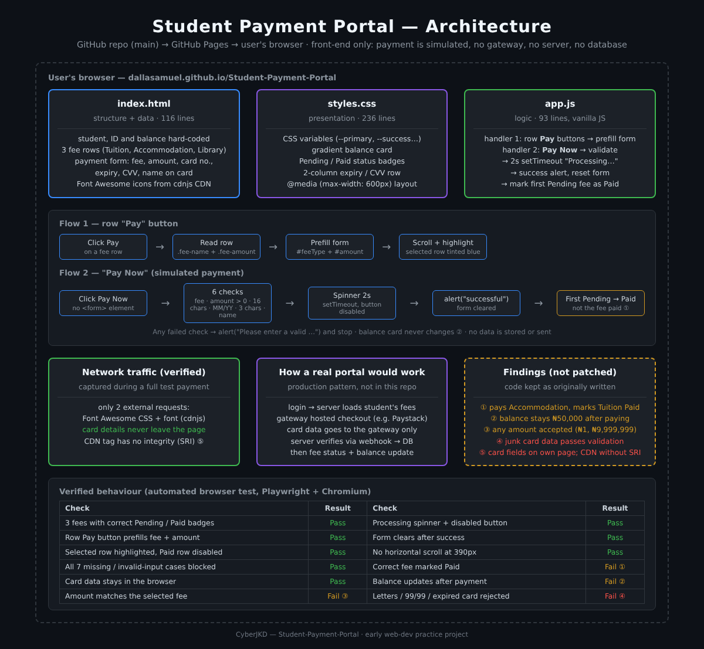
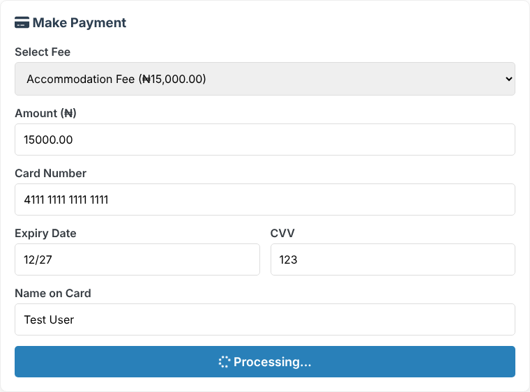
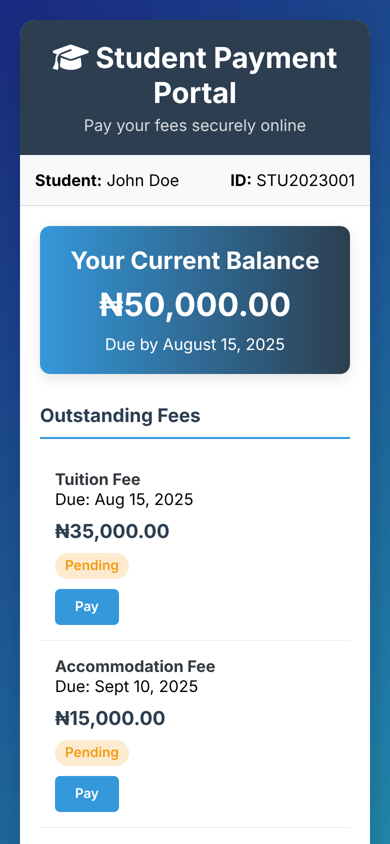
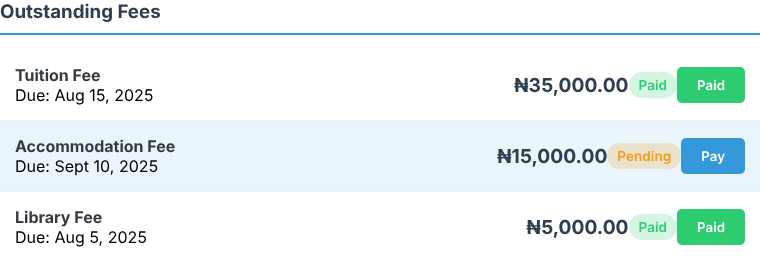
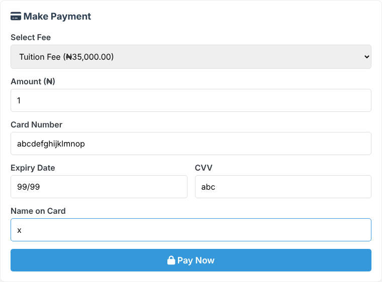

# Student Payment Portal - Front-End Fee Payment UI


| | |
|---|---|
| **Author** | Dalla Samuel (CyberJKD) |
| **Type** | Early web-dev practice project |
| **Platform** | Browser (client-side only) · hosted on GitHub Pages |
| **Payment** | Simulated. No payment gateway, no server, no real charges |
| **Live Demo** | [dallasamuel.github.io/Student-Payment-Portal](https://dallasamuel.github.io/Student-Payment-Portal/) |

> ⚠️ **Demo only. Do not enter real card details.** Nothing is charged and, as tested below, nothing is sent anywhere, but this page is a UI exercise, not a payment system.


---

## Objective

Build the front end of a school fee payment portal with plain HTML, CSS and JavaScript: show a student's balance and outstanding fees, let them pick a fee to pay, collect payment details in a form, check the input, and show a processing state and a success message.

> **The code is kept exactly as I first wrote it, on purpose.** I came back later, tested it the way I test my labs now, and documented what works and what doesn't (see [Findings](#findings)). Payment systems are where small front-end mistakes turn into security and money problems, so this repo is a good record of the gap between "looks like a payment page" and "is a payment system".

## Problem It Solves

Many schools still take fees through slow manual processes: bank tellers, printed receipts, queues at the bursary. A portal that shows exactly what is owed and lets a student pay online removes most of that. This project builds the part the student sees: the balance, the fee list with Pending/Paid status, and the payment form.

## Environment

| Component | Value |
|---|---|
| Languages | HTML5, CSS3, JavaScript (ES6+) |
| Frameworks / libraries | None. Font Awesome 6.4.0 icons loaded from the cdnjs CDN |
| Data | Hard-coded in `index.html`: one student, ₦50,000 balance, 3 fees |
| Hosting | GitHub Pages, `main` branch |
| Files | `index.html` (116 lines) · `styles.css` (236 lines) · `app.js` (93 lines) |
| Test tooling (added later, not in the repo) | Playwright + Chromium, desktop 900px and phone 390px viewports, with network capture |

## Key Concepts

- **DOM traversal**: `closest('.fee-item')` finds the row a button belongs to, then `querySelector` reads that row's fee name and amount.
- **Event listeners**: one listener per row **Pay** button, one on **Pay Now**.
- **Client-side validation**: required fields, amount greater than zero, card number length, `MM/YY` pattern, CVV length.
- **Simulated async work**: `setTimeout` holds a disabled "Processing…" button for 2 seconds to stand in for a real payment call.
- **UI state through CSS classes**: switching `status-pending` → `status-paid` and `btn-primary` → `btn-success` changes how a fee row looks.
- **Responsive CSS**: CSS variables for the colour theme, plus a `@media (max-width: 600px)` rule that stacks the fee rows on phones.

## Architecture



```
GitHub repo: DallaSamuel/Student-Payment-Portal (main)
   │
   ▼
GitHub Pages ──► https://dallasamuel.github.io/Student-Payment-Portal/
   │
   ▼
User's browser (everything runs here, payment is simulated)
   ├── index.html   → student info, ₦50,000 balance, 3 fee rows, payment form (hard-coded)
   ├── styles.css   → theme variables, balance card, status badges, 600px media query
   ├── app.js
   │     ├── row "Pay" buttons → read row → prefill #feeType + #amount → scroll + highlight
   │     └── "Pay Now"         → 6 checks → 2s "Processing…" → success alert
   │                              → reset form → mark FIRST Pending fee as Paid
   └── cdnjs.cloudflare.com  → Font Awesome CSS + font (the only external requests)
```

**Flow 1, row Pay button:** read that row's fee name and amount → fill the form → scroll to it → tint the row blue.
**Flow 2, Pay Now:** run the checks (any failure shows an alert and stops) → spinner for 2 seconds → "Payment of ₦… was successful!" → clear the form → flip a fee row to Paid.

### How a real portal would work (not in this repo)

```
Student logs in ──► Server loads that student's fees from a database
       │
       ▼
Clicks Pay ──► Server creates a payment session with a gateway (e.g. Paystack / Flutterwave)
       │
       ▼
Gateway's hosted checkout collects the card ──► card data never touches the school's servers
       │
       ▼
Gateway webhook ──► server verifies the signature and amount ──► marks THAT fee Paid, updates balance
```

## Features

| Feature | How it works |
|---|---|
| Student summary | Name, student ID and total balance with due date. |
| Fee list | Tuition, Accommodation and Library fees with amount, due date and a Pending/Paid badge. Paid fees have a disabled button. |
| One-click fill | A row's **Pay** button fills the fee and amount into the form, scrolls down and highlights that row. |
| Input checks | Blocks an empty fee, a missing or zero/negative amount, a card number that isn't 16 characters, a missing `MM/YY` date, a CVV that isn't 3 characters, and an empty name. |
| Processing state | **Pay Now** turns into a disabled "Processing…" spinner for 2 seconds. |
| Success flow | Success message, form cleared, a fee row switches to Paid. |
| Responsive | Fee rows stack on screens under 600px. No sideways scrolling at 390px. |

<table>
<tr>
<td width="62%"></td>
<td width="38%"></td>
</tr>
<tr>
<td align="center"><sub>Pay Now → "Processing…" (button disabled)</sub></td>
<td align="center"><sub>Phone layout, 390px wide</sub></td>
</tr>
</table>

## Run It Locally

```bash
# Clone
git clone https://github.com/DallaSamuel/Student-Payment-Portal.git
cd Student-Payment-Portal

# Open in a browser, no install or build step
start index.html      # Windows
open index.html       # macOS
xdg-open index.html   # Linux
```

Test card for the demo: `4111 1111 1111 1111`, any future `MM/YY`, CVV `123`.

## Verification Checklist

Tested in a real browser (Playwright driving Chromium) against the original, unmodified code, with every network request recorded.

- [x] Balance shows ₦50,000.00 and the 3 fees show the right Pending/Paid badges
- [x] A row's Pay button fills in the correct fee and amount
- [x] The selected row is highlighted and the already-paid row's button is disabled
- [x] All 7 missing or invalid-input cases (empty fee, empty/negative amount, short card, bad date, short CVV, empty name) are blocked with the right message
- [x] Pay Now shows "Processing…" and is disabled while processing
- [x] Success message appears and the form clears afterwards
- [x] Card details are never sent anywhere: the only external requests were the Font Awesome CSS and font
- [x] No sideways scrolling at phone width (390px)
- [x] Fee rows stack correctly under 600px
- [x] Live site on GitHub Pages loads the portal
- [ ] The fee that was paid is the one marked Paid: **fails, see Finding 1**
- [ ] Balance goes down after a payment: **fails, see Finding 2**
- [ ] Amount must match the selected fee: **fails, see Finding 3**
- [ ] Card number with letters, impossible or expired dates and a letter CVV are rejected: **fails, see Finding 4**

## Findings

I'm building toward cloud security, so I reviewed my early code like I'd review anyone else's. The code stays as it was. These are documented, not patched.

**1. The wrong fee gets marked Paid (logic).** After a successful payment, the code marks the *first* Pending fee on the page as Paid, not the fee that was selected:

```javascript
const firstPending = document.querySelector('.status-pending');
```

Paying the **Accommodation Fee** marked **Tuition Fee** as Paid and left Accommodation as Pending.
*Fix:* remember which fee was selected (from `#feeType`) and update that row only.



**2. The balance never changes (logic).** The ₦50,000.00 balance is static text. It still showed ₦50,000.00 after a successful ₦15,000 payment.
*Fix:* calculate the balance from the Pending fees and recalculate it after every payment.

**3. Any amount is accepted (business logic).** The amount field only has to be more than zero. Paying ₦1 against the ₦35,000 Tuition Fee showed "Payment of ₦1 was successful!", and so did ₦9,999,999 against the ₦15,000 Accommodation Fee.
*Fix:* lock the amount to the selected fee (or allow part-payments up to the amount owed), and in a real system let the **server** decide the amount, never the browser.

**4. Card checks only test length (input validation).** Each of these was accepted as a "successful" payment:

| Input | Value tested | Why it passed |
|---|---|---|
| Card number | `abcdefghijklmnop` | Only the length (16) is checked, not that it's digits, and there's no Luhn checksum |
| Expiry | `99/99`, `01/20` (expired) | Month and year are never range-checked or compared to today |
| Expiry | `x12/345` | The regex `/\d{2}\/\d{2}/` has no `^…$` anchors, so it matches anywhere in the text |
| CVV | `abc` | Only the length (3) is checked |

*Fix:* digits-only and Luhn checks, a real month/year check against today, `^\d{3,4}$` for the CVV. In production the gateway does this validation anyway.



**5. Payment security design (security).**
- **Card fields on your own page.** Collecting the card number, expiry and CVV in your own form puts the site in scope for **PCI DSS**, the card industry's security standard. Real portals hand this to the gateway's hosted checkout or hosted fields so the card data never touches their code. This demo is safe only because the data goes nowhere (confirmed by the network capture).
- **CDN stylesheet without Subresource Integrity.** The Font Awesome stylesheet is loaded from cdnjs with no `integrity` attribute. If that file were ever tampered with, the page would load it anyway. On a payment page, every third-party file should have an SRI hash or be self-hosted.
- **No `<form>`, `autocomplete` or masking.** The inputs aren't in a `<form>`, have no `autocomplete="cc-number"`/`"cc-exp"`/`"cc-csc"` hints, and the CVV shows in plain text.
- **No login.** The student ("John Doe", STU2023001) is hard-coded. A real portal must authenticate the student and load their own fees from the server.

## What I'd Change for Production

- **Use a payment gateway** (e.g. Paystack or Flutterwave) with hosted checkout, so card data never touches this site and PCI DSS scope stays minimal (Finding 5).
- **Backend + database + login**: the server owns fees, balances and amounts, and the browser only displays them (Findings 2, 3, 5).
- **Confirm payments on the server** with a signed webhook from the gateway before marking anything Paid. Never trust a success message created in the browser.
- **Update the fee that was actually paid** and recalculate the balance (Findings 1, 2).
- **Strict validation** with digits-only, Luhn, date-range and anchored patterns, as a usability layer on top of the gateway's own checks (Finding 4).
- **SRI hashes or self-hosted icons**, plus a Content Security Policy limiting which domains can load scripts and styles (Finding 5).
- **Accessible feedback**: show error messages next to each field instead of `alert()` pop-ups, and give each input proper `autocomplete` attributes.
- **Receipts and an audit trail**: a payment reference and a downloadable receipt for every transaction.

## Where It Led

This was an early web project. Since then my work has moved into **Azure cloud support and IT support**: Terraform, Active Directory, NTFS file servers, Splunk, Nessus and ServiceNow, all documented in the same style as this README.

---

🌐 Full roadmap: [dallasamuel.github.io/CyberJKD-Roadmap](https://dallasamuel.github.io/CyberJKD-Roadmap)

🔗 All labs: [github.com/DallaSamuel/CyberJKD-Labs](https://github.com/DallaSamuel/CyberJKD-Labs)

👤 GitHub profile: [@DallaSamuel](https://github.com/DallaSamuel) · LinkedIn: [dallasamuel](https://www.linkedin.com/in/dallasamuel)

---

*CyberJKD - Becoming dangerous through fundamentals. 🔒*
